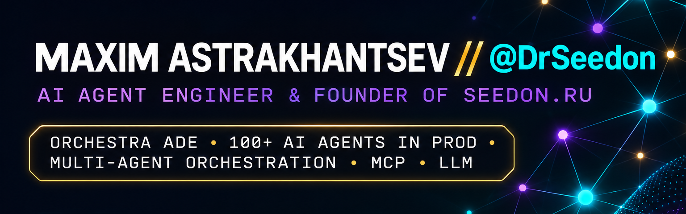

# Maxim Astrakhantsev · @DrSeedon

**AI Agent Engineer · Founder of [seedon.ru](https://seedon.ru)**
Multi-Agent Systems · Model Context Protocol (MCP) · Production LLMs

---

## 🚀 What I Do

I build production LLM systems: autonomous multi-agent platforms, enterprise tool integrations, and reliability/cost control pipelines. All commercial B2B AI products, **Orchestra ADE**, and enterprise case studies live on **[seedon.ru](https://seedon.ru)**. This profile hosts my open-source work and engineering experiments.

| | |
|---|---|
| 🎼 **[Orchestra ADE](https://github.com/DrSeedon/orchestra)** | Open-source Agentic Development Environment: 4 runtimes under a unified control plane (Claude, Codex, Grok, OpenRouter), per-agent `git worktree` isolation, automated cross-vendor review before merge, 10+ custom MCP servers, 2,600+ automated tests |
| 🤖 **[100+ AI Agents in Production](https://seedon.ru)** | Multi-agent engineering and enterprise operations: commercial deployment running 87 agents, 8,274 verified tool calls, and a 114M-record data pipeline |
| 🔌 **MCP & Tool Calling** | Idempotent tool execution, operation audit logs, post-action verification, permission tiers, and human-in-the-loop escalation |
| 🗄️ **Data & RAG Pipelines** | 10⁸-record cross-matching pipelines, hybrid dense/sparse search (`bge-m3`), PostgreSQL / SQLite |

## 📂 Open Source

- **[orchestra](https://github.com/DrSeedon/orchestra)** — Agentic Development Environment (ADE) for autonomous engineering teams: agent mail, budget-aware task manager, `git worktree` isolation, and mandatory cross-model review before merge
- **[Claude-Code-Game-Master](https://github.com/DrSeedon/Claude-Code-Game-Master)** — Claude Code as a persistent tabletop RPG Game Master powered by RAG and structured rule engines
- **[kesha-tg-bot](https://github.com/DrSeedon/kesha-tg-bot)** — 24/7 autonomous Telegram assistant built on the Claude Agent SDK
- **[mcp-websearch](https://github.com/DrSeedon/mcp-websearch)** — MCP server for real-time web research via Perplexity Sonar and image generation
- **[yougile-mcp](https://github.com/DrSeedon/yougile-mcp)** · **[gpb-mcp](https://github.com/DrSeedon/gpb-mcp)** — Specialized MCP servers for project management and enterprise integrations

## 🛠️ Tech Stack

Prior to AI engineering — 6 years building Unity games, VR/AR simulators, and industrial/medical software.

## 📫 Contact

- 🌐 Website & Case Studies: **[seedon.ru](https://seedon.ru)**
- 💬 Telegram: [@DrSeedon](https://t.me/DrSeedon)
- ✉️ Email: [maxim2000as@gmail.com](mailto:maxim2000as@gmail.com)
- 💼 LinkedIn: [linkedin.com/in/maxim-astrakhantsev-13a9391b9](https://www.linkedin.com/in/maxim-astrakhantsev-13a9391b9)
- 🎨 Personal Portfolio: [drseedon.github.io/web_portfolio](https://drseedon.github.io/web_portfolio/)

---

<b>🇷🇺 Русская версия (Russian translation)</b> — также доступна отдельным файлом <a href="./README.ru.md">README.ru.md</a>

 

### Максим Астраханцев · AI Agent Engineer · основатель [seedon.ru](https://seedon.ru)

Строю production-системы на LLM: агентные платформы, интеграции, контроль качества и стоимости. Главные B2B AI-продукты, **Orchestra ADE**, кейсы и вся работа компании — на **[seedon.ru](https://seedon.ru)**. Здесь — личная страница и открытый код.

| Направление | Описание |
|---|---|
| 🎼 **[Orchestra ADE](https://github.com/DrSeedon/orchestra)** | Открытый оркестратор AI-агентов: 4 рантайма под одним контуром (Claude, Codex, Grok, OpenRouter), изоляция агентов через `git worktree`, кросс-ревью другой моделью, 10+ собственных MCP-серверов, 2 600+ автотестов |
| 🤖 **[100+ AI-агентов в проде](https://seedon.ru)** | Мультиагентная разработка и эксплуатация: коммерческое внедрение — 87 агентов, 8 274 вызова инструментов, массив на 114 млн записей |
| 🔌 **MCP и tool calling** | Идемпотентность, журнал операций, перепроверка результата, классы прав действий, human-in-the-loop |
| 🗄️ **Данные и RAG** | Пайплайны на 10⁸ записей, гибридный поиск, PostgreSQL / SQLite |

**Открытый код:**
- **[orchestra](https://github.com/DrSeedon/orchestra)** — ADE для команды агентов: агентная почта, таск-менеджер с бюджетами, worktree-изоляция, кросс-модельное ревью перед merge
- **[Claude-Code-Game-Master](https://github.com/DrSeedon/Claude-Code-Game-Master)** — Claude Code как мастер игры: RAG и правила RPG для постоянного приключения
- **[kesha-tg-bot](https://github.com/DrSeedon/kesha-tg-bot)** — Telegram-бот на Claude Code SDK
- **[mcp-websearch](https://github.com/DrSeedon/mcp-websearch)** — MCP-сервер: веб-поиск через Perplexity Sonar и генерация изображений
- **[yougile-mcp](https://github.com/DrSeedon/yougile-mcp)** · **[gpb-mcp](https://github.com/DrSeedon/gpb-mcp)** — специализированные MCP-серверы

**Контакты:**
- 🌐 Сайт и кейсы: **[seedon.ru](https://seedon.ru)**
- 💬 Telegram: [@DrSeedon](https://t.me/DrSeedon)
- ✉️ Email: [maxim2000as@gmail.com](mailto:maxim2000as@gmail.com)
- 💼 LinkedIn: [linkedin.com/in/maxim-astrakhantsev-13a9391b9](https://www.linkedin.com/in/maxim-astrakhantsev-13a9391b9)

До AI — 6 лет Unity, VR/AR и промышленного софта. Полная русская версия: **[README.ru.md](./README.ru.md)**.

