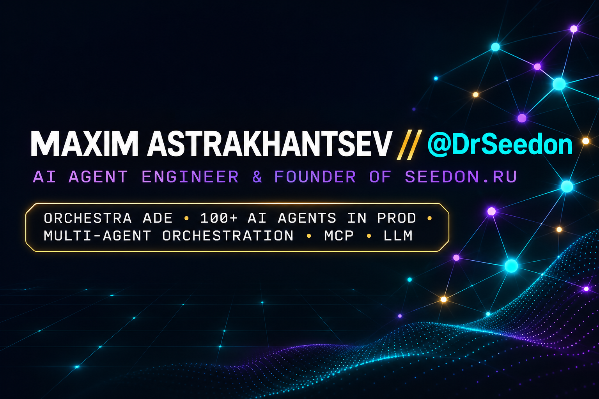

# Максим Астраханцев · @DrSeedon

**AI Agent Engineer · основатель [seedon.ru](https://seedon.ru)**
Мультиагентные системы · MCP · LLM в проде

---

## 🚀 Чем занимаюсь

Строю production-системы на LLM: агентные платформы, интеграции, контроль качества и стоимости. Главные B2B AI-продукты, **Orchestra ADE**, кейсы и вся работа компании — на **[seedon.ru](https://seedon.ru)**. Здесь — личная страница и открытый код.

| | |
|---|---|
| 🎼 **[Orchestra ADE](https://github.com/DrSeedon/orchestra)** | Открытый оркестратор AI-агентов: 4 рантайма под одним контуром (Claude, Codex, Grok, OpenRouter), изоляция агентов через `git worktree`, кросс-ревью другой моделью, 10+ собственных MCP-серверов, 2 600+ автотестов |
| 🤖 **[100+ AI-агентов в проде](https://seedon.ru)** | Мультиагентная разработка и эксплуатация: коммерческое внедрение — 87 агентов, 8 274 вызова инструментов, массив на 114 млн записей |
| 🔌 **MCP и tool calling** | Идемпотентность, журнал операций, перепроверка результата, классы прав действий, human-in-the-loop |
| 🗄️ **Данные и RAG** | Пайплайны на 10⁸ записей, гибридный поиск (`bge-m3`), PostgreSQL / SQLite |
| 🧬 **Контрибуции в AI-рантаймы** | Официальный контрибьютор **[pingdotgg/t3code](https://github.com/pingdotgg/t3code)** и **[openai/codex](https://github.com/openai/codex)** — мультиагентная оркестрация и ядро агентных рантаймов |

## 📂 Открытый код

- **[orchestra](https://github.com/DrSeedon/orchestra)** — ADE для команды агентов: агентная почта, таск-менеджер с бюджетами, worktree-изоляция, кросс-модельное ревью перед merge
- **[pingdotgg/t3code](https://github.com/pingdotgg/t3code)** · **[openai/codex](https://github.com/openai/codex)** — контрибуции в ядро мультиагентных платформ и CLI-рантаймов
- **[Claude-Code-Game-Master](https://github.com/DrSeedon/Claude-Code-Game-Master)** — Claude Code как мастер игры: RAG и правила RPG для постоянного приключения
- **[kesha-tg-bot](https://github.com/DrSeedon/kesha-tg-bot)** — Telegram-бот на Claude Code SDK
- **[mcp-websearch](https://github.com/DrSeedon/mcp-websearch)** — MCP-сервер: веб-поиск через Perplexity Sonar и генерация изображений
- **[yougile-mcp](https://github.com/DrSeedon/yougile-mcp)** · **[gpb-mcp](https://github.com/DrSeedon/gpb-mcp)** — специализированные MCP-серверы

## 🛠️ Стек

До AI — 6 лет Unity, VR/AR и промышленного софта.

## 📫 Связаться

- 🌐 Сайт и кейсы: **[seedon.ru](https://seedon.ru)**
- 💬 Telegram: [@DrSeedon](https://t.me/DrSeedon)
- ✉️ Email: [maxim2000as@gmail.com](mailto:maxim2000as@gmail.com)
- 💼 LinkedIn: [linkedin.com/in/maxim-astrakhantsev-13a9391b9](https://www.linkedin.com/in/maxim-astrakhantsev-13a9391b9)
- 🎨 Портфолио: [drseedon.github.io/web_portfolio](https://drseedon.github.io/web_portfolio/)
